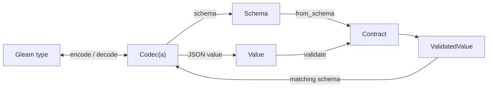

# JSON Blueprint

Define a JSON codec in Gleam to encode native values, decode JSON strictly, and
publish a Draft 2020-12 schema from the same definition.

[](https://hex.pm/packages/json_blueprint)
[](https://hexdocs.pm/json_blueprint/)

JSON Blueprint 2.0 includes typed codecs, exact JSON values, runtime schema
contracts, and build-time source generators in one package. The legacy decoder
and schema modules remain available for applications upgrading from 1.x.

## When to use it

- Define an API or event type once when your Gleam application needs typed JSON
  encoding, decoding, and a schema for that same shape.
- Validate arguments against a schema received at runtime, such as a tool
  declaration, when the schema fits the supported profile below.
- Admit untrusted JSON text with duplicate-key rejection, exact numbers, and
  a configurable byte limit. Applications own additional structural limits.

For ordinary serialization, `gleam/json` is enough. Applications own HTTP,
authorization, protocol policy, and effects in custom callbacks.

## Capabilities

- A `Codec(a)` combines native encoding and decoding; built-in codecs also
  describe their JSON schema.
- Record codecs declare required and optional fields. Combine `optional_field`
  with `nullable` when absence and JSON `null` must have different meanings.
- Tagged unions represent sum types as `{"tag": "...", "value": ...}`;
  unit variants omit `value`.
- Built-in codecs cover strings, booleans, integers, exact numbers, lists,
  pairs, enums, nullable values, and inclusive numeric bounds.
- `map`, `try_map`, and `custom` adapt application types; later fields can be
  checked against fields already decoded.
- Encode and decode failures carry JSON paths, and definition mistakes have
  typed errors. Native parse-error locations are unavailable.
- `value.parse` admits bounded text, preserves exact JSON numbers, and rejects
  repeated object keys. `Value` can also bridge to `gleam/json` and
  `gleam/dynamic/decode`.
- Runtime `Contract`s load schemas, validate `Value`s, and decode validated
  values only with a codec whose schema matches.
- Opaque schemas can be rendered as JSON or inspected with `codec.view` for
  consumer-side translation.
- Included source generators produce specialized functions for an existing
  native type, or native records and a codec from a supported schema.

## Core model



These are immutable values and synchronous calls. A `Contract` retains schema
acceptance, while a `Codec(a)` owns conversion to and from an application type.

## Installation

The 2.x APIs require JSON Blueprint 2.0.0 or later. Once 2.0.0 is available on
Hex, install it with:

```sh
gleam add json_blueprint@2
```
Published 1.7.1 provides the legacy `json/blueprint` and
`json/blueprint/schema` modules. To stay on that API:

```sh
gleam add json_blueprint@1.7.1
```

Before upgrading an existing application, follow the
[2.0 migration guide](https://github.com/lostbean/json_blueprint/blob/main/docs/MIGRATION.md).
The package upgrade and adopting codecs are separate changes.

## Define a codec

This record codec makes a field required or optional, then uses the same
definition to decode, encode, and publish the schema.

<!-- prettier-ignore-start -->

<!-- snips: examples/src/examples/record.gleam#record -->
```gleam
import gleam/option.{type Option}
import gleam/result
import json/blueprint/codec.{type Codec}

pub type Role {
  Admin
  Member
}

pub type User {
  User(name: String, age: Int, email: Option(String), role: Role)
}

pub fn user_codec() -> Codec(User) {
  let role = codec.string_enum([#("admin", Admin), #("member", Member)])
  use name <- codec.field("name", codec.string(), get: fn(u) { u.name })
  use age <- codec.field("age", codec.integer_between(0, 150), get: fn(u) {
    u.age
  })
  use email <- codec.optional_field("email", codec.string(), get: fn(u) {
    u.email
  })
  use role <- codec.field("role", role, get: fn(u) { u.role })
  codec.success(User(name:, age:, email:, role:))
}

pub fn round_trip() -> Result(User, String) {
  let text = "{\"name\":\"Ada\",\"age\":36,\"role\":\"admin\"}"
  use user <- result.try(
    codec.decode_json(user_codec(), text)
    |> result.map_error(codec.describe_decode_error),
  )
  let assert Ok(_text) = codec.encode_json(user_codec(), user)
  let assert Ok(_schema) = codec.schema_json(user_codec())
  Ok(user)
}

```

<!-- prettier-ignore-end -->

Built-in record decoding rejects unknown fields, duplicate keys, and wrong
types. Errors identify the path, for example
`$["age"]: integer outside range 0 to 150`. Custom callbacks define their own
effects and laws.

## Tagged unions

With `json/blueprint/codec.{type Codec}` imported, describe each constructor and
provide the total match from the Gleam type:

<!-- prettier-ignore-start -->

<!-- snips: examples/src/examples/unions.gleam#tagged-union -->
```gleam
pub type Shape {
  Circle(radius: Int)
  Label(text: String)
  Empty
}

pub fn shape_codec() -> Codec(Shape) {
  codec.union({
    use circle <- codec.variant("circle", codec.int(), Circle)
    use label <- codec.variant("label", codec.string(), Label)
    use empty <- codec.unit_variant("empty", Empty)
    codec.match(fn(shape) {
      case shape {
        Circle(radius) -> circle(radius)
        Label(text) -> label(text)
        Empty -> empty
      }
    })
  })
}

```

<!-- prettier-ignore-end -->

The wire forms are `{"tag":"circle","value":2}` and `{"tag":"empty"}`.
Gleam checks that the `case` covers every constructor.

<a id="defaults"></a>

## Parsing and runtime requirements

`value.default_limits()` admits at most 1 MiB of UTF-8 text. Change this with
`value.with_max_bytes` and pass the result to `codec.decode_json_with_limits`,
`value.parse`, or `contract.parse`. There are no global depth, value-count or
numeric-token limits. Consumers own structural admission policies; a byte
limit is not a heap quota.

Both targets decode built-in codecs directly from native parser output, avoiding
an intermediate `Value` tree. Erlang/OTP 27+ uses JSON parser hooks; JavaScript
uses `JSON.parse` with numeric source text and a duplicate-key/Unicode scan
and requires runtime support for source text; older runtimes return
`UnsupportedRuntime`. No portable parser fallback is included.
Exact numbers and duplicate rejection are retained. Custom callbacks receive a
converted subtree. Native parsing changes object order and precise parse
locations; typed field/index errors remain. See [the migration guide](https://github.com/lostbean/json_blueprint/blob/main/docs/MIGRATION.md)
and [browser support and executed checks](https://github.com/lostbean/json_blueprint/blob/main/docs/BROWSER-SUPPORT.md).

## Schema support

The runtime contract loader supports the finite profile described by codecs:
closed objects, homogeneous lists, pairs, nullable values, bounded integers
and numbers, string enums, tagged unions, and any JSON value. It refuses other
schema forms instead of silently dropping constraints; this is not general
JSON Schema validation. See the [oracle and its limits](https://github.com/lostbean/json_blueprint/blob/main/docs/ORACLE.md).

`codec.int()` accepts at most 24 digits and, on JavaScript, must stay within the
safe integer range. Use `codec.number()` for larger exact values.
`codec.decoder` inherits the parser's precision, duplicate-key, and resource
behavior.

## Upgrading from 1.x

Follow the [2.0 migration guide](https://github.com/lostbean/json_blueprint/blob/main/docs/MIGRATION.md) when upgrading from
published 1.7.1. You can keep using `json/blueprint` and
`json/blueprint/schema`; adopting the codec API is a separate application
change. Keep the legacy decoder for recursive types. The legacy API is frozen,
not formally deprecated; it has no `@deprecated` annotations.

1. Build `Decoder` and `FieldDecoder` with the published combinators. Their
   constructors and record fields are now opaque.
2. Replace imports of the removed `json/blueprint/dynamic` module with the
   appropriate `gleam/dynamic/decode` API. `get_dynamic_decoder` still returns
   a function, and its errors now use that module's `DecodeError` type.
3. Check large inputs: `blueprint.decode` now rejects text above 1 MiB of UTF-8
   before parsing. Use `blueprint.decode_with_max_bytes` for an explicit larger
   bound.
4. Run your stored JSON and schema fixtures before adopting codecs. Codec
   records reject unknown fields, optional fields distinguish absence from
   `null`, and union/enum wire forms differ from the legacy encoders.

The [compiled migration example](https://github.com/lostbean/json_blueprint/blob/main/examples/test/migration_test.gleam) exercises
both APIs and their wire differences on Erlang and JavaScript. The guide covers
parser limits, schema support, exact numbers, and source generation as well.

## Build-time generation

Generate reviewable Gleam source through two development-time paths:

- A caller-authored typed `Definition(a)` generates specialized encoder, decoder, and schema functions for an existing native type.
- An [admitted closed-object schema](#generate-native-records-from-a-schema) generates native record types and an ordinary typed codec.

Your build task writes, formats, and compiles the returned source. Both paths use
JSON Blueprint at runtime.

The generators are included in `json_blueprint` under
`json/blueprint/codegen` and `json/blueprint/codegen/schema`. The same dependency
supplies the runtime and generators; no separate `json_blueprint_codegen`
package is needed. Choose a dependency from [Installation](#installation).

<!-- prettier-ignore-start -->

<!-- snips: test/module_docs/codegen_example_test.gleam#codegen-example -->
```gleam
import json/blueprint/codec
import json/blueprint/codegen

pub fn names_definition() -> codegen.Definition(List(String)) {
  codegen.list(codegen.string())
}

pub fn example() {
  let assert Ok(["a", "b"]) =
    codec.decode_json(codegen.runtime(names_definition()), "[\"a\",\"b\"]")
  // In a build task: write `content` to "src/" <> path.
  let assert Ok(codegen.GeneratedModule(path:, content:, fingerprint: _)) =
    codegen.compile("generated/names_codec", "names", names_definition())
  #(path, content)
}

```

<!-- prettier-ignore-end -->

- A `Definition(a)` mirrors the codec shapes: `string`, `int`, `number`,
  `bool`, `integer_between`, `pair`, `list`, `nullable`, `string_enum`,
  `required` and `optional` properties joined with `combine` and closed with
  `object`, and `imap` with a `named_mapping`.
- `runtime(definition)` returns its codec for interpreted use. Applications
  using generated functions need JSON Blueprint and generated source.
- `compile(module_path, name, definition)` returns the module source. Write
  it under `src/`, run `gleam format` on it, and add a test that compiles it
  again and compares, as the [compiled fixture test](https://github.com/lostbean/json_blueprint/blob/main/test/compiled_codec_test.gleam)
  does here. Generation does not write files or start a process.
- A generated module exports `encode_<name>`, `decode_<name>`,
  `encode_<name>_json`, `decode_<name>_json` (strict parser),
  `decode_<name>_json_native` (`gleam/json`, 1 MiB pre-check),
  `<name>_schema()` and `<name>_codec()`.
- The generated codec accessor uses specialized text encoding and direct typed
  decoding through ordinary `codec.encode_json` and `codec.decode_json` calls.
  Strict decoding shares the runtime parser, including duplicate-key rejection,
  exact numeric conversion, Unicode checks, and byte limits. No extra parser or
  global cache is installed.
- Generated schema structures avoid rediscovering the definition; schema JSON
  still renders on demand. Wrapping a generated codec in an ordinary container
  or mapping preserves behavior and direct child decoding, but text encoding
  uses the ordinary Value path. Generate the whole definition to specialize it.
- A generated object codec can be a field or collection element, but cannot
  finish a `codec.field` or `codec.optional_field` record continuation. Use an
  ordinary runtime record builder when extending a record; the generated codec
  replaces value, text, and schema operations, not the builder capability.
- Named source callbacks must be pure and agree with their supplied runtime
  functions. Generated schema and known-field metadata do not replay runtime
  placeholder introspection; equal conversion results do not imply equal
  callback effects during schema or field discovery.
  Exact `Number` definitions work through `runtime`, but typed `compile` still
  returns `NativeNumberUnsupported`; the schema-driven generator below supports
  exact numbers through ordinary codecs.

From the repository root in its Nix shell, regenerate its fixtures with:

```sh
gleam run -m compiled_codec_runner
gleam run -m schema_codegen_runner
gleam format test/generated
```

From the repository root, `nix develop --command sh scripts/benchmark.sh` runs the timing harness on both targets and writes a fresh evidence directory. [ADR 0008](https://github.com/lostbean/json_blueprint/blob/main/docs/adr/0008-development-time-source-generation.md) records generation ownership and the remaining scope, and [ADR 0010](https://github.com/lostbean/json_blueprint/blob/main/docs/adr/0010-retain-benchmark-observations-as-non-asserting-evidence.md) records the measurement policy; method, provenance and retained results are in [docs/BENCHMARKS.md](https://github.com/lostbean/json_blueprint/blob/main/docs/BENCHMARKS.md).

### Generate native records from a schema

- The separate `json/blueprint/codegen/schema` module accepts an admitted closed-object `codec.Schema` and explicit module and root names. Its `compile` function returns the same `GeneratedModule` source record as the typed-definition generator.
- A generated schema module exports native root and nested record types plus one root codec accessor. Applications use ordinary `codec.encode`, `codec.decode`, and their strict text counterparts with that codec.
- Supported children include closed records, strings, booleans, native integers and integer ranges, exact numbers and number ranges, lists, pairs, nullable values, and optional properties. Constraints and descriptions survive generation; supported structure is checked by Gleam on outbound native values while ordinary codecs check value constraints.
- Wire names are preserved. Native names are deterministic; invalid names, name collisions, and unsupported shapes return typed failures with logical schema locations instead of partial source.
- Enums, tagged unions, unconstrained values, shared or recursive definitions, and non-object roots are outside this generation slice. Runtime-schema admission does not imply generation support.
- The [separate order consumer](https://github.com/lostbean/json_blueprint/blob/main/examples/codegen/README.md) demonstrates the complete workflow, including a schema file, development-only generation task, committed output, application-owned policy, recovery, both runtime targets, and freshly generated-code integration tests. Its production package depends only on JSON Blueprint and compiled source.
- Generated codecs use public runtime combinators and add no second contract-validation pass. Codec accessors construct values on each call; retain a codec for repeated use. [ADR 0010](https://github.com/lostbean/json_blueprint/blob/main/docs/adr/0010-retain-benchmark-observations-as-non-asserting-evidence.md) records the separate construction, conversion, and build-time generation costs.

## Examples and references

The [examples](https://github.com/lostbean/json_blueprint/blob/main/examples/README.md) compile and run on Erlang and JavaScript.
The [design](https://github.com/lostbean/json_blueprint/blob/main/docs/design/design-layer.pdf) records behavior and ownership. The
[benchmark report](https://github.com/lostbean/json_blueprint/blob/main/docs/BENCHMARKS.md) retains local observations without
performance guarantees.
