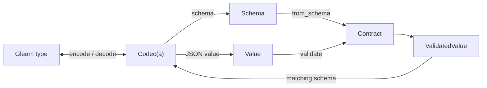

# JSON Blueprint

> **Version 3.0.0 is a breaking release.** Read the
> [migration guide](https://github.com/gleam-dream/json_blueprint/blob/main/docs/MIGRATION.md)
> before upgrading from 2.x or 1.x.
>
> - Every text decoder now refuses input nested deeper than 128 levels (and
>   larger than 1 MiB) by default. Raise the bound with `value.with_max_depth`,
>   or use `value.unlimited()` for trusted text.
> - The 1.x modules `json/blueprint` and `json/blueprint/schema` are removed.
>   Use codecs.
> - Generated codecs no longer export `decode_<name>_json_native`. Call
>   `decode_<name>_json` and regenerate checked-in modules.
> - `contract.parse` now accepts and ignores annotation keywords such as
>   `title` and `default`.
> - Dependents move their range to `>= 3.0.0 and < 4.0.0`.

[](https://github.com/gleam-dream/json_blueprint/actions/workflows/test.yml)
[](https://hex.pm/packages/json_blueprint)
[](https://gleam.run/)
[](https://hexdocs.pm/json_blueprint/)

Define a JSON codec in Gleam to encode native values, decode JSON strictly, and
publish a Draft 2020-12 schema from the same definition.

JSON Blueprint includes typed codecs, exact JSON values, runtime schema
contracts, and build-time source generators in one package. Every text
decoder parses within a byte bound and a nesting-depth bound by default.

## When to use it

- Define an API or event type once when your Gleam application needs typed JSON
  encoding, decoding, and a schema for that same shape.
- Validate arguments against a schema received at runtime, such as a tool
  declaration, when the schema fits the supported profile below.
- Admit untrusted JSON text with duplicate-key rejection, exact numbers, and
  byte and nesting-depth limits that are on by default.

For ordinary serialization, `gleam/json` is enough. Applications own HTTP,
authorization, protocol policy, and effects in custom callbacks.

## Capabilities

- A `Codec(a)` combines native encoding and decoding; built-in codecs also
  describe their JSON schema.
- Record codecs declare required and optional fields. Combine `optional_field`
  with `nullable` when absence and JSON `null` must have different meanings.
- Tagged unions represent sum types as `{"tag": "...", "value": ...}`;
  unit variants omit `value`.
- Built-in codecs cover strings, booleans, integers, exact numbers, lists,
  pairs, enums, nullable values, and inclusive numeric bounds.
- `map`, `try_map`, and `custom` adapt application types; later fields can be
  checked against fields already decoded.
- Encode and decode failures carry JSON paths, and definition mistakes have
  typed errors. Native parse-error locations are unavailable.
- `value.parse` admits bounded text, preserves exact JSON numbers, and rejects
  repeated object keys. `Value` can also bridge to `gleam/json` and
  `gleam/dynamic/decode`.
- Runtime `Contract`s load schemas, validate `Value`s, and decode validated
  values only with a codec whose schema matches.
- Opaque schemas can be rendered as JSON or inspected with `codec.view` for
  consumer-side translation. `codec.map_enum_labels` and
  `codec.map_descriptions` derive a schema with other labels or descriptions.
- Included source generators produce specialized functions for an existing
  native type, or native records and a codec from a supported schema.

## Core model



These are immutable values and synchronous calls. A `Contract` retains schema
acceptance, while a `Codec(a)` owns conversion to and from an application type.

## Installation

Install JSON Blueprint 3 from Hex:

```sh
gleam add json_blueprint@3
```

The 1.x `json/blueprint` and `json/blueprint/schema` modules are removed in
3.0; 2.x releases still include them. Before upgrading an existing
application from 2.x or 1.x, follow the
[migration guide](https://github.com/gleam-dream/json_blueprint/blob/main/docs/MIGRATION.md).

## Choosing a codec

A codec holds each of its inputs once, so sending it to another BEAM process
copies about its own size (a codec value you use in several places is still
copied once per place).

- Generate the codec from a typed definition when its JSON shape is fixed at
  build time and the codec is hot, long-lived, or sent to or held by other
  processes, directly or inside a value such as an agent or a tool definition.
  A generated codec refers to module functions and literals and captures no
  child codec, so it stays small to send. Sending decoded data costs the same
  with either kind of codec.
- Write it with combinators when the shape depends on run-time values, needs
  tagged unions, shared definitions or recursion, uses `custom`, `value` or
  arbitrary `try_map`, or is used once. For a fixed shape that is neither hot
  nor held by other processes, default to combinators.
The [codec practice guide](https://github.com/gleam-dream/json_blueprint/blob/main/docs/CODEC-PRACTICE.md) gives the measurements, the rules for
combinator codecs with examples, a copy-size test, and the generator's current
gaps.

## Define a codec

This record codec makes a field required or optional, then uses the same
definition to decode, encode, and publish the schema.

<!-- prettier-ignore-start -->

<!-- snips: examples/src/examples/record.gleam#record -->
```gleam
import gleam/option.{type Option}
import gleam/result
import json/blueprint/codec.{type Codec}

pub type Role {
  Admin
  Member
}

pub type User {
  User(name: String, age: Int, email: Option(String), role: Role)
}

pub fn user_codec() -> Codec(User) {
  use name <- codec.field("name", codec.string(), get: fn(u) { u.name })
  use age <- codec.field("age", codec.integer_between(0, 150), get: fn(u) {
    u.age
  })
  use email <- codec.optional_field("email", codec.string(), get: fn(u) {
    u.email
  })
  use role <- codec.field(
    "role",
    codec.string_enum([#("admin", Admin), #("member", Member)]),
    get: fn(u) { u.role },
  )
  codec.success(User(name:, age:, email:, role:))
}

pub fn round_trip() -> Result(User, String) {
  let text = "{\"name\":\"Ada\",\"age\":36,\"role\":\"admin\"}"
  use user <- result.try(
    codec.decode_json(user_codec(), text)
    |> result.map_error(codec.describe_decode_error),
  )
  let assert Ok(_text) = codec.encode_json(user_codec(), user)
  let assert Ok(_schema) = codec.schema_json(user_codec())
  Ok(user)
}

```

<!-- prettier-ignore-end -->

Built-in record decoding rejects unknown fields, duplicate keys, and wrong
types. Errors identify the path, for example
`$["age"]: integer outside range 0 to 150`. Custom callbacks define their own
effects and laws.

## Tagged unions

With `json/blueprint/codec.{type Codec}` imported, describe each constructor and
provide the total match from the Gleam type:

<!-- prettier-ignore-start -->

<!-- snips: examples/src/examples/unions.gleam#tagged-union -->
```gleam
pub type Shape {
  Circle(radius: Int)
  Label(text: String)
  Empty
}

pub fn shape_codec() -> Codec(Shape) {
  codec.union({
    use circle <- codec.variant("circle", codec.int(), Circle)
    use label <- codec.variant("label", codec.string(), Label)
    use empty <- codec.unit_variant("empty", Empty)
    codec.match(fn(shape) {
      case shape {
        Circle(radius) -> circle(radius)
        Label(text) -> label(text)
        Empty -> empty
      }
    })
  })
}

```

<!-- prettier-ignore-end -->

The wire forms are `{"tag":"circle","value":2}` and `{"tag":"empty"}`.
Gleam checks that the `case` covers every constructor.

<a id="defaults"></a>

## Parsing and runtime requirements

`value.default_limits()` admits at most 1 MiB of UTF-8 text nested at most 128
levels deep, the recursion limit `serde_json` uses. Change either bound with
`value.with_max_bytes` or `value.with_max_depth` and pass the result to
`codec.decode_json_with_limits`, `value.parse`, or `contract.parse`. A deeper
document fails with `DepthLimitExceeded`. `value.unlimited()` removes both
bounds; use it only for trusted text. The byte limit also bounds the number of
values. There is no numeric-token limit, and a byte limit is not a heap quota.

Both targets decode built-in codecs directly from native parser output, avoiding
an intermediate `Value` tree. Erlang/OTP 27+ uses JSON parser hooks; JavaScript
uses `JSON.parse` with numeric source text and a duplicate-key/Unicode scan
and requires runtime support for source text; older runtimes return
`UnsupportedRuntime`. No portable parser fallback is included.
Exact numbers and duplicate rejection are retained. Custom callbacks receive a
converted subtree. Native parsing changes object order and precise parse
locations; typed field/index errors remain. See [the migration guide](https://github.com/gleam-dream/json_blueprint/blob/main/docs/MIGRATION.md)
and [browser support and executed checks](https://github.com/gleam-dream/json_blueprint/blob/main/docs/BROWSER-SUPPORT.md).

## Schema support

The runtime contract loader supports the finite profile described by codecs:
closed objects, homogeneous lists, pairs, nullable values, bounded integers
and numbers, string enums, tagged unions, and any JSON value. It refuses other
schema forms instead of silently dropping constraints; this is not general
JSON Schema validation. See the [oracle and its limits](https://github.com/gleam-dream/json_blueprint/blob/main/docs/ORACLE.md).

`codec.int()` accepts at most 24 digits and, on JavaScript, must stay within the
safe integer range. Use `codec.number()` for larger exact values.
`codec.decoder` inherits the parser's precision, duplicate-key, and resource
behavior.

## Upgrading from 1.x

The 1.x `Decoder` API (`json/blueprint` and `json/blueprint/schema`) has been
removed: it parsed with `gleam/json` behind a byte check only, which let deeply
nested input past the default depth bound. The
[migration guide](https://github.com/gleam-dream/json_blueprint/blob/main/docs/MIGRATION.md#the-1x-api-is-removed)
maps each 1.x form to its replacement:

1. Record, list, optional, tuple, union and enum decoders become codecs built
   with `codec.field`, `codec.optional_field`, `codec.list`, `codec.pair`,
   `codec.union` and `codec.string_enum`. Codec records reject unknown fields,
   optional fields distinguish absence from `null`, and union/enum wire forms
   differ from the 1.x encoders: replay stored JSON before switching.
2. `blueprint.decode` becomes `codec.decode_json`, and
   `decode_with_max_bytes` becomes `codec.decode_json_with_limits` with
   `value.with_max_bytes`.
3. Recursive types (`self_decoder`, `reuse_decoder`) have no codec form. Parse
   with `value.parse(text, value.default_limits())` and walk the `Value` with
   your own function; no schema is derived for them.

The [compiled migration example](https://github.com/gleam-dream/json_blueprint/blob/main/examples/test/migration_test.gleam)
shows each replacement and wire difference on Erlang and JavaScript.

## Build-time generation

Generate reviewable Gleam source through two development-time paths:

- A caller-authored typed `Definition(a)` generates specialized encoder, decoder, and schema functions for an existing native type.
- An [admitted closed-object schema](#generate-native-records-from-a-schema) generates native record types and an ordinary typed codec.

Your build task writes, formats, and compiles the returned source. Both paths use
JSON Blueprint at runtime. The [codec practice guide](https://github.com/gleam-dream/json_blueprint/blob/main/docs/CODEC-PRACTICE.md#choose-generated-codecs-or-combinators)
says when a generated codec is the better choice.

`json_blueprint` includes the runtime and both generators,
`json/blueprint/codegen` and `json/blueprint/codegen/schema`; no separate
`json_blueprint_codegen` package is needed. Choose a dependency from
[Installation](#installation).

<!-- prettier-ignore-start -->

<!-- snips: test/module_docs/codegen_example_test.gleam#codegen-example -->
```gleam
import json/blueprint/codec
import json/blueprint/codegen

pub fn names_definition() -> codegen.Definition(List(String)) {
  codegen.list(codegen.string())
}

pub fn example() {
  let assert Ok(["a", "b"]) =
    codec.decode_json(codegen.runtime(names_definition()), "[\"a\",\"b\"]")
  // In a build task: write `content` to "src/" <> path.
  let assert Ok(codegen.GeneratedModule(path:, content:, fingerprint: _)) =
    codegen.compile("generated/names_codec", "names", names_definition())
  #(path, content)
}

```

<!-- prettier-ignore-end -->

- A `Definition(a)` mirrors the codec shapes: `string`, `int`, `number`,
  `bool`, `integer_between`, `pair`, `list`, `nullable`, `string_enum`,
  `required` and `optional` properties joined with `combine` and closed with
  `object`, and `imap` with a `named_mapping`.
- `runtime(definition)` returns its codec for interpreted use. Applications
  using generated functions need JSON Blueprint and generated source.
- `compile(module_path, name, definition)` returns the module source. Write
  it under `src/`, run `gleam format` on it, and add a test that compiles it
  again and compares, as the [compiled fixture test](https://github.com/gleam-dream/json_blueprint/blob/main/test/compiled_codec_test.gleam)
  does here. Generation does not write files or start a process.
- A generated module exports `encode_<name>`, `decode_<name>`,
  `encode_<name>_json`, `decode_<name>_json` (the strict parser with the
  default limits), `<name>_schema()` and `<name>_codec()`.
- The generated codec accessor uses specialized text encoding and direct typed
  decoding through ordinary `codec.encode_json` and `codec.decode_json` calls.
  Strict decoding shares the runtime parser, including duplicate-key rejection,
  exact numeric conversion, Unicode checks, and byte and depth limits. No extra parser or
  global cache is installed.
- Generated schema structures avoid rediscovering the definition; schema JSON
  still renders on demand. Wrapping a generated codec in an ordinary container
  or mapping preserves behavior and direct child decoding, but text encoding
  uses the ordinary Value path. Generate the whole definition to specialize it.
- A generated object codec can be a field or collection element, but cannot
  finish a `codec.field` or `codec.optional_field` record continuation. Use an
  ordinary runtime record builder when extending a record; the generated codec
  replaces value, text, and schema operations, not the builder capability.
- Named source callbacks must be pure and agree with their supplied runtime
  functions. Generated schema and known-field metadata do not replay runtime
  placeholder introspection; equal conversion results do not imply equal
  callback effects during schema or field discovery.
  Exact `Number` definitions work through `runtime`, but typed `compile` still
  returns `NativeNumberUnsupported`; the schema-driven generator below supports
  exact numbers through ordinary codecs.

From the repository root in its Nix shell, regenerate its fixtures with:

```sh
gleam run -m compiled_codec_runner
gleam run -m schema_codegen_runner
gleam format test/generated
```

From the repository root, `nix develop --command sh scripts/benchmark.sh` runs the timing harness on both targets and writes a fresh evidence directory. [ADR 0008](https://github.com/gleam-dream/json_blueprint/blob/main/docs/adr/0008-development-time-source-generation.md) records generation ownership and the remaining scope, and [ADR 0010](https://github.com/gleam-dream/json_blueprint/blob/main/docs/adr/0010-retain-benchmark-observations-as-non-asserting-evidence.md) records the measurement policy; method, provenance and retained results are in [docs/BENCHMARKS.md](https://github.com/gleam-dream/json_blueprint/blob/main/docs/BENCHMARKS.md).

### Generate native records from a schema

- The separate `json/blueprint/codegen/schema` module accepts an admitted closed-object `codec.Schema` and explicit module and root names. Its `compile` function returns the same `GeneratedModule` source record as the typed-definition generator.
- A generated schema module exports native root and nested record types plus one root codec accessor. Applications use ordinary `codec.encode`, `codec.decode`, and their strict text counterparts with that codec.
- Supported children include closed records, strings, booleans, native integers and integer ranges, exact numbers and number ranges, lists, pairs, nullable values, and optional properties. Constraints and descriptions survive generation; supported structure is checked by Gleam on outbound native values while ordinary codecs check value constraints.
- Wire names are preserved. Native names are deterministic; invalid names, name collisions, and unsupported shapes return typed failures with logical schema locations instead of partial source.
- Enums, tagged unions, unconstrained values, shared or recursive definitions, and non-object roots are outside this generation slice. Runtime-schema admission does not imply generation support.
- The [separate order consumer](https://github.com/gleam-dream/json_blueprint/blob/main/examples/codegen/README.md) demonstrates the complete workflow, including a schema file, development-only generation task, committed output, application-owned policy, recovery, both runtime targets, and freshly generated-code integration tests. Its production package depends only on JSON Blueprint and compiled source.
- Generated codecs use public runtime combinators and add no second contract-validation pass. Codec accessors construct values on each call; retain a codec for repeated use in the process that uses it. Their output is combinator code, so the [codec practice guide](https://github.com/gleam-dream/json_blueprint/blob/main/docs/CODEC-PRACTICE.md) applies before a schema-generated codec is sent to another process. [ADR 0010](https://github.com/gleam-dream/json_blueprint/blob/main/docs/adr/0010-retain-benchmark-observations-as-non-asserting-evidence.md) records the separate construction, conversion, and build-time generation costs.

## Examples and references

The [examples](https://github.com/gleam-dream/json_blueprint/blob/main/examples/README.md) compile and run on Erlang and JavaScript.
The [codec practice guide](https://github.com/gleam-dream/json_blueprint/blob/main/docs/CODEC-PRACTICE.md) says when to generate a codec and how to write
combinator codecs that stay cheap to send between processes.
The [design](https://github.com/gleam-dream/json_blueprint/blob/main/docs/design/design-layer.pdf) records behavior and ownership. The
[benchmark report](https://github.com/gleam-dream/json_blueprint/blob/main/docs/BENCHMARKS.md) retains local observations without
performance guarantees.
