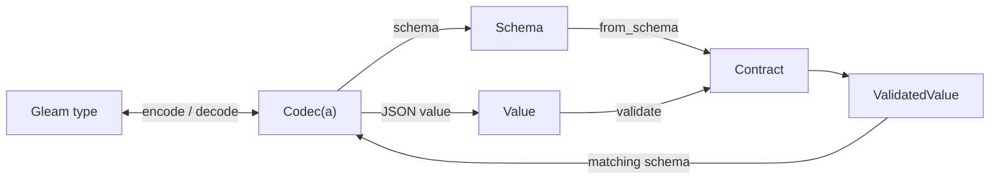

# JSON Blueprint

Define a JSON codec in Gleam to encode native values, decode JSON strictly, and
publish a Draft 2020-12 schema from the same definition.

[](https://hex.pm/packages/json_blueprint)
[](https://hexdocs.pm/json_blueprint/)

The codec and runtime-contract APIs described here are unreleased work toward
2.0. The published 1.7.1 package provides the frozen 1.x API.

## When to use it

- Define an API or event type once when your Gleam application needs typed JSON
  encoding, decoding, and a schema for that same shape.
- Validate arguments against a schema received at runtime, such as a tool
  declaration, when the schema fits the supported profile below.
- Admit untrusted JSON text with duplicate-key rejection, exact numbers, and
  explicit size, nesting, value-count, and number limits.

For ordinary serialization, `gleam/json` is enough. Applications own HTTP,
authorization, protocol policy, and effects in custom callbacks.

## Capabilities

- A `Codec(a)` combines native encoding and decoding; built-in codecs also
  describe their JSON schema.
- Record codecs declare required and optional fields. Combine `optional_field`
  with `nullable` when absence and JSON `null` must have different meanings.
- Tagged unions represent sum types as `{"tag": "...", "value": ...}`;
  unit variants omit `value`.
- Built-in codecs cover strings, booleans, integers, exact numbers, lists,
  pairs, enums, nullable values, and inclusive numeric bounds.
- `map`, `try_map`, and `custom` adapt application types; later fields can be
  checked against fields already decoded.
- Encode and decode failures carry JSON paths; parse failures locate the source
  position, and definition mistakes have typed errors.
- `value.parse` admits bounded text, preserves exact JSON numbers, and rejects
  repeated object keys. `Value` can also bridge to `gleam/json` and
  `gleam/dynamic/decode`.
- Runtime `Contract`s load schemas, validate `Value`s, and decode validated
  values only with a codec whose schema matches.
- Opaque schemas can be rendered as JSON or inspected with `codec.view` for
  consumer-side translation.

## Core model



These are immutable values and synchronous calls. A `Contract` retains schema
acceptance, while a `Codec(a)` owns conversion to and from an application type.

## Installation

Use the repository's `main` branch to try the unreleased codec and
runtime-contract APIs:

```toml
[dependencies]
json_blueprint = { git = "https://github.com/lostbean/json_blueprint.git", ref = "main" }
```

Gleam records the resolved Git commit in `manifest.toml`; commit that file to
keep builds pinned to the same revision.

For the published 1.x API in `json/blueprint` and `json/blueprint/schema`:

```sh
gleam add json_blueprint@1.7.1
```

## Define a codec

This record codec makes a field required or optional, then uses the same
definition to decode, encode, and publish the schema.

<!-- prettier-ignore-start -->

<!-- snips: examples/src/examples/record.gleam#record -->
```gleam
import gleam/option.{type Option}
import gleam/result
import json/blueprint/codec.{type Codec}

pub type Role {
  Admin
  Member
}

pub type User {
  User(name: String, age: Int, email: Option(String), role: Role)
}

pub fn user_codec() -> Codec(User) {
  let role = codec.string_enum([#("admin", Admin), #("member", Member)])
  use name <- codec.field("name", codec.string(), get: fn(u) { u.name })
  use age <- codec.field("age", codec.integer_between(0, 150), get: fn(u) {
    u.age
  })
  use email <- codec.optional_field("email", codec.string(), get: fn(u) {
    u.email
  })
  use role <- codec.field("role", role, get: fn(u) { u.role })
  codec.success(User(name:, age:, email:, role:))
}

pub fn round_trip() -> Result(User, String) {
  let text = "{\"name\":\"Ada\",\"age\":36,\"role\":\"admin\"}"
  use user <- result.try(
    codec.decode_json(user_codec(), text)
    |> result.map_error(codec.describe_decode_error),
  )
  let assert Ok(_text) = codec.encode_json(user_codec(), user)
  let assert Ok(_schema) = codec.schema_json(user_codec())
  Ok(user)
}

```

<!-- prettier-ignore-end -->

Built-in record decoding rejects unknown fields, duplicate keys, and wrong
types. Errors identify the path, for example
`$["age"]: integer outside range 0 to 150`. Custom callbacks define their own
effects and laws.

## Tagged unions

With `json/blueprint/codec.{type Codec}` imported, describe each constructor and
provide the total match from the Gleam type:

<!-- prettier-ignore-start -->

<!-- snips: examples/src/examples/unions.gleam#tagged-union -->
```gleam
pub type Shape {
  Circle(radius: Int)
  Label(text: String)
  Empty
}

pub fn shape_codec() -> Codec(Shape) {
  codec.union({
    use circle <- codec.variant("circle", codec.int(), Circle)
    use label <- codec.variant("label", codec.string(), Label)
    use empty <- codec.unit_variant("empty", Empty)
    codec.match(fn(shape) {
      case shape {
        Circle(radius) -> circle(radius)
        Label(text) -> label(text)
        Empty -> empty
      }
    })
  })
}

```

<!-- prettier-ignore-end -->

The wire forms are `{"tag":"circle","value":2}` and `{"tag":"empty"}`.
Gleam checks that the `case` covers every constructor.

## Defaults

`value.default_limits()` sets strict text parsing to 1 MiB of UTF-8, depth 64,
262,144 values, and number limits of 1,024 token bytes, 800 significant digits,
and exponent magnitude 1,200. `codec.decode_json` uses these defaults;
`value.parse` and `contract.parse` take explicit limits. Adjust them with
`value.with_max_bytes`, `value.with_max_depth`, `value.with_max_elements`, or
`value.with_number_limits`, then pass them to `codec.decode_json_with_limits`
or `contract.parse`. Raising the byte limit does not raise the value limit or
bound heap use. `contract.validate` and `contract.load` add no resource bounds;
parse untrusted text with explicit limits first.

## Schema support

The runtime contract loader supports the finite profile described by codecs:
closed objects, homogeneous lists, pairs, nullable values, bounded integers
and numbers, string enums, tagged unions, and any JSON value. It refuses other
schema forms instead of silently dropping constraints; this is not general
JSON Schema validation. See the [oracle and its limits](docs/ORACLE.md).

`codec.int()` accepts at most 24 digits and, on JavaScript, must stay within the
safe integer range. Use `codec.number()` for larger exact values.
`codec.decoder` inherits the parser's precision, duplicate-key, and resource
behavior. Browser JavaScript is not tested.

## Upgrading from 1.x

Code using the published 1.x combinators can continue with that API. In this
checkout, the 1.x decoder remains the choice for recursive types. Legacy unions
use `{"type": ..., "data": ...}` and enum encoders use `{"enum": ...}`;
codecs use `{"tag": ..., "value": ...}` and a bare string for an enum. Legacy
optional fields also treat absence and `null` alike. Review the migration
example before changing stored or exchanged JSON.

Three changes in this checkout:

- `json/blueprint/dynamic` is internal. Import `gleam/dynamic/decode` instead.
- `Decoder` and `FieldDecoder` are opaque; build them with combinators rather
  than record syntax. `get_dynamic_decoder` returns
  `fn(Dynamic) -> Result(t, List(decode.DecodeError))` with the same
  `expected`, `found`, and `path` fields.
- `blueprint.decode` rejects text above 1 MiB before parsing, with a
  `json.UnableToDecode` error naming the limit. Use
  `blueprint.decode_with_max_bytes` to raise that bound.

The [migration example](examples/test/migration_test.gleam) compiles and runs
the same record through both APIs and shows the wire differences to review.
The 1.x schema module describes a broader set of forms; it is not the runtime
contract validator described above.

## Build-time generation

Generate reviewable Gleam source through two development-time paths:

- A caller-authored typed `Definition(a)` generates specialized encoder, decoder, and schema functions for an existing native type.
- An [admitted closed-object schema](#generate-native-records-from-a-schema) generates native record types and an ordinary typed codec.

Your build task writes, formats, and compiles the returned source. Both paths use
JSON Blueprint at runtime.

The generators are included in `json_blueprint` under
`json/blueprint/codegen` and `json/blueprint/codegen/schema`. The codec API and
generators in this checkout are unreleased. Use the checkout by path until its
release version is decided; no separate generator dependency is required:

```toml
[dependencies]
json_blueprint = { path = "../json_blueprint" }
```

<!-- prettier-ignore-start -->

<!-- snips: test/module_docs/codegen_example_test.gleam#codegen-example -->
```gleam
import json/blueprint/codec
import json/blueprint/codegen

pub fn names_definition() -> codegen.Definition(List(String)) {
  codegen.list(codegen.string())
}

pub fn example() {
  let assert Ok(["a", "b"]) =
    codec.decode_json(codegen.runtime(names_definition()), "[\"a\",\"b\"]")
  // In a build task: write `content` to "src/" <> path.
  let assert Ok(codegen.GeneratedModule(path:, content:, fingerprint: _)) =
    codegen.compile("generated/names_codec", "names", names_definition())
  #(path, content)
}

```

<!-- prettier-ignore-end -->

- A `Definition(a)` mirrors the codec shapes: `string`, `int`, `number`,
  `bool`, `integer_between`, `pair`, `list`, `nullable`, `string_enum`,
  `required` and `optional` properties joined with `combine` and closed with
  `object`, and `imap` with a `named_mapping`.
- `runtime(definition)` returns its codec for interpreted use. Applications
  using generated functions need JSON Blueprint and generated source.
- `compile(module_path, name, definition)` returns the module source. Write
  it under `src/`, run `gleam format` on it, and add a test that compiles it
  again and compares, as the [compiled fixture test](test/compiled_codec_test.gleam)
  does here. Generation does not write files or start a process.
- A generated module exports `encode_<name>`, `decode_<name>`,
  `encode_<name>_json`, `decode_<name>_json` (strict parser),
  `decode_<name>_json_native` (`gleam/json`, 1 MiB pre-check),
  `<name>_schema()` and `<name>_codec()`.

From the repository root in its Nix shell, regenerate its fixtures with:

```sh
gleam run -m compiled_codec_runner
gleam run -m schema_codegen_runner
gleam format test/generated
```

From the repository root, `nix develop --command sh scripts/benchmark.sh` runs the timing harness on both targets and writes a fresh evidence directory. [ADR 0008](docs/adr/0008-development-time-source-generation.md) records generation ownership and the remaining scope, and [ADR 0010](docs/adr/0010-retain-benchmark-observations-as-non-asserting-evidence.md) records the measurement policy; method, provenance and retained results are in [docs/BENCHMARKS.md](docs/BENCHMARKS.md).

### Generate native records from a schema

- The separate `json/blueprint/codegen/schema` module accepts an admitted closed-object `codec.Schema` and explicit module and root names. Its `compile` function returns the same `GeneratedModule` source record as the typed-definition generator.
- A generated schema module exports native root and nested record types plus one root codec accessor. Applications use ordinary `codec.encode`, `codec.decode`, and their strict text counterparts with that codec.
- Supported children include closed records, strings, booleans, native integers and integer ranges, exact numbers and number ranges, lists, pairs, nullable values, and optional properties. Constraints and descriptions survive generation; supported structure is checked by Gleam on outbound native values while ordinary codecs check value constraints.
- Wire names are preserved. Native names are deterministic; invalid names, name collisions, and unsupported shapes return typed failures with logical schema locations instead of partial source.
- Enums, tagged unions, unconstrained values, shared or recursive definitions, and non-object roots are outside this generation slice. Runtime-schema admission does not imply generation support.
- The [separate order consumer](examples/codegen/README.md) demonstrates the complete workflow, including a schema file, development-only generation task, committed output, application-owned policy, recovery, both runtime targets, and freshly generated-code integration tests. Its production package depends only on JSON Blueprint and compiled source.
- Generated codecs use public runtime combinators and add no second contract-validation pass. Codec accessors construct values on each call; retain a codec for repeated use. [ADR 0010](docs/adr/0010-retain-benchmark-observations-as-non-asserting-evidence.md) records the separate construction, conversion, and build-time generation costs.

## Examples and references

The [examples](examples/README.md) compile and run on Erlang and JavaScript.
The [design](docs/design/design-layer.pdf) records behavior and ownership. The
[benchmark report](docs/BENCHMARKS.md) retains local observations without
performance guarantees.
